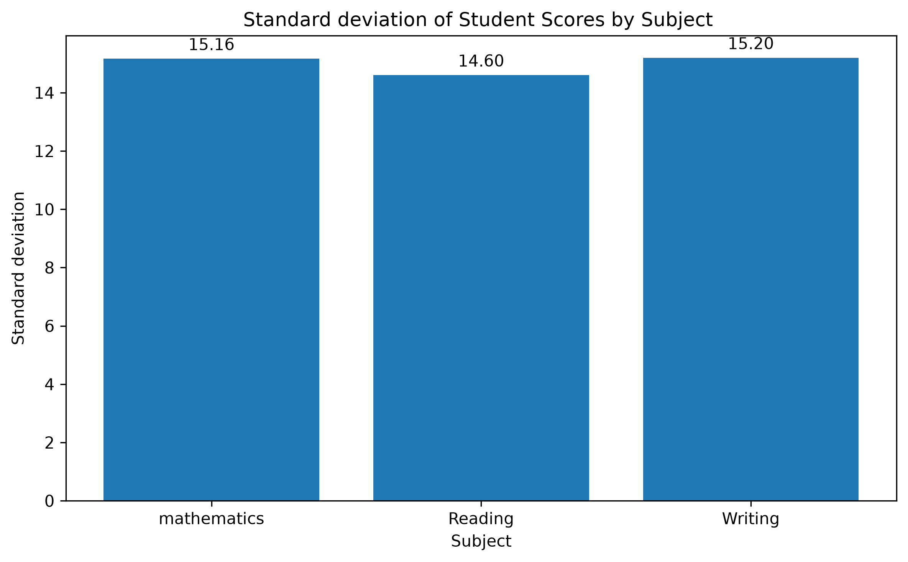

# Student Performance Statistical Analysis

## Project Overview
This project uses Python and pandas to analyze student exam scores in mathematics, reading, and writing.

## Dataset
The dataset contains 1,000 students and 8 columns. It is the Students Performance in Exams dataset from Kaggle.

## Tools Used
- Python
- pandas
- Matplotlib

## Analysis Performed
- Checked for missing values
- Calculated mean, median, and mode
- Calculated range and standard deviation
- Created a histogram
- Compared average scores across subjects
- Calculated the difference between writing and mathematics averages

## Comparing the spread of scores  across the subjects
The standard deviations of mathematics, reading, and writing scores were approximately 
15.16, 14.60, and 15.20, respectively. 
Writing scores showed the greatest variability, while reading scores showed the lowest variability.
However, the differences were small, suggesting that the overall spread of scores was fairly similar 
across the three subjects.

## Results and Findings

### Standard Deviation Comparison

The standard deviations of student scores were:

| Subject | Standard Deviation |
|---|---:|
| Mathematics | 15.16 |
| Reading | 14.60 |
| Writing | 15.20 |

### Interpretation

- Writing scores had the highest standard deviation (15.20).
- Reading scores had the lowest standard deviation (14.60).
- Mathematics had a standard deviation of 15.16.
- The differences between the three standard deviations were small, suggesting that score variability was fairly 
- similar across the subjects.

Standard deviation measures the spread of scores around their mean. 
These results describe variability and do not establish which subject
was easiest or hardest.

## Visualizations

### Standard Deviation Comparison

The chart below compares the variability of student scores in mathematics, reading, and writing.

## Average Score Analysis

The average scores for the three subjects were:

| Subject | Average Score |
|---|---:|
| Mathematics | 66.09 |
| Reading | 69.17 |
| Writing | 68.05 |

### Key Findings

- Reading had the highest average score at 69.17.
- Mathematics had the lowest average score at 66.09.
- The difference between the highest and lowest averages was 3.08 points.

These averages describe the overall performance of the students.
They do not prove that one subject was necessarily easier than another.